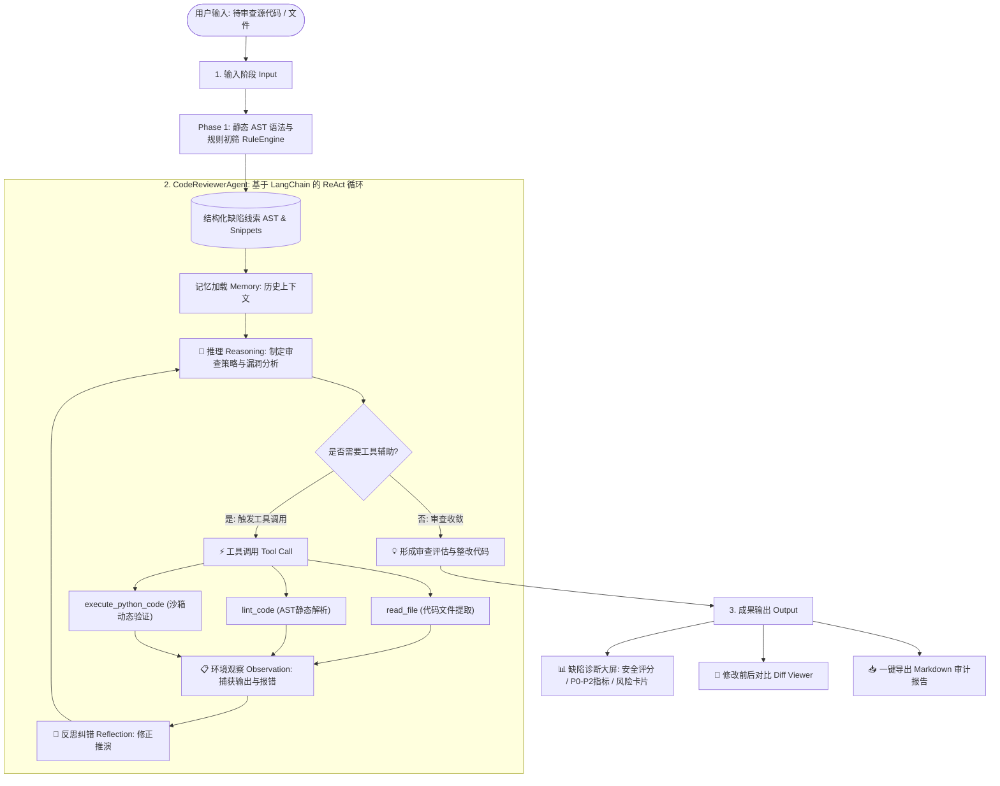

# 🛡️ CodeReviewerAgent: 基于 LangChain 的智能代码审查与质量分析助手

[](https://www.python.org/)
[](https://python.langchain.com/)
[-purple.svg)](https://www.deepseek.com/)
[](LICENSE)
[]()

> **CodeReviewerAgent** 围绕课程大作业规范核心主题打造：
> **「代码审查Agent | 分析代码质量、发现潜在Bug、给出改进建议 | LLM调用、Prompt设计、代码解析」**。
> 系统底层全面基于主流智能体框架 **LangChain** 构建，严格实现 **`输入 ➔ 推理 (Reasoning) ➔ 工具调用 (Action) ➔ 环境反馈 (Observation) ➔ 成果输出 (Output)`** 的完整 ReAct 循环，集成 **文件读取、AST静态代码解析、沙箱代码执行与单测自纠错**，具备 **多轮上下文记忆** 与 **错误重试/超时熔断机制**，提供 **Rich 终端交互 CLI** 与 **现代可视化 Web 交互工作台** 双入口。

---

## 🏛️ 系统架构设计与 ReAct 循环流



---

## 🛠️ 集成的 LangChain 标准工具集

平台将底层工程函数封装为 LangChain 标准的 `StructuredTool`，动态注入 Agent：

| 工具名称 (`Tool`) | 职责定位 | 典型应用场景 |
| :--- | :--- | :--- |
| **`read_file`** | 安全文件读取 | 审查外部指定路径的 `.py` 脚本内容 |
| **`lint_code`** | AST 语法与规则扫描 | 零 LLM 极速提取函数类列表、参数量超标、静态语法错误 |
| **`execute_python_code`** | 隔离子进程沙箱执行 | 动态运行可疑代码，验证是否真实触发 `ZeroDivisionError` 或 `ValueError` |
| **`run_pytest`** | 自动化测试套件执行 | 运行单元测试套件，执行测试-纠错自闭环验证 |
| **`search_code_snippets`** | 代码关键词与正则搜索 | 快速检索全局硬编码配置、裸 except 等模式 |

---

## 🛡️ 核心亮点：工业级智能代码审查 (Code Review) 体系

本系统的核心亮点在于构建了 **全自动化、深层次、闭环式的智能代码审查 (Code Review) 引擎**。不同于传统单次调用大模型的浅层问答，系统采用动静结合的两阶段流水线，专注于深度挖掘潜在运行时崩溃与安全隐患，并提供立即可验证的修复方案：

### 1. 两阶段智能混合审查流水线 (Hybrid Review Pipeline)
- **Phase 1: 静态 AST 规则极速初筛 (RuleEngine)**：
  - 基于 Python 原生抽象语法树（AST）进行零开销毫秒级解析；
  - 核心针对四大致命隐患进行模式匹配与特征提取：
    - 🔴 **除零崩溃风险** (`ZeroDivisionError`): 空容器长度作除数、未做分母非零防护；
    - 🟠 **资源未释放泄漏** (`Resource Leak`): 裸 `open()` 打开文件未通过 `with` 上下文管理器正确关闭句柄；
    - 🔴 **空序列极值/越界崩溃** (`ValueError/IndexError`): 在空列表上直接调用 `max()`/`min()` 导致程序致命崩溃；
    - 🟠 **异常静默吞噬掩盖** (`Bare Except`): 使用裸 `except:` 或捕获后直接 `pass`，掩盖底层系统严重缺陷。
- **Phase 2: 深度 ReAct 专家审查 (CodeReviewerAgent)**：
  - 将 Phase 1 提取的结构化特征线索注入 LangChain Agent 上下文；
  - Agent 结合业务场景与执行路径进行多步深度推理，必要时调用沙箱工具动态触发验证，输出成因机理与针对性修复方案；
- **Phase 3: 交叉验证与去重排序 (Verifier)**：
  - 自动整合静态规则结果与 Agent 深度审计建议，去重并按危害严重级别优先级降序排列。

### 2. 工业级多层级缺陷诊断与机理透视 (Deep Risk Diagnosis)
- **严格三级严重度分级**：
  - 🔴 **致命崩溃 (P0 - CRITICAL)**：除零、空序列操作、下标越界等可导致服务直接宕机的严重缺陷；
  - 🟠 **高危安全与泄漏 (P1 - HIGH)**：未关文件句柄资源泄漏、裸 except 静默吞异常等潜在高危隐患；
  - 🔵 **中危与可维护性 (P2 - MEDIUM)**：参数过多、过度嵌套、类型不安全等代码异味与架构坏味道。
- **高可读性结构化缺陷卡片**：
  - 每一处风险均提供：**缺陷编号 `[R-01]`**、**精准原代码行号**、**缺陷代码片段切片**、**底层成因剖析** 及 **AI 推荐整改方案**；
  - 源码视图精准关联高亮：行号旁边醒目标记风险芯片（🔴 Critical / 🟠 High / 🔵 Medium），支持平滑滚动与强对比高亮定位。

### 3. 量化安全健康评分与评级模型 (Health Score & Grade)
- **科学加权扣分评估算法**：
  $$\text{Health Score} = \max(0, 100 - N_{\text{crit}} \times 25 - N_{\text{high}} \times 15 - N_{\text{med}} \times 5)$$
- **四级直观质量评级**：
  - `90 - 100` 分 ➔ **A (优秀)**：代码规范严密，无高危及致命缺陷；
  - `75 - 89` 分 ➔ **B (良好)**：存在轻微可维护性建议，可直接上线；
  - `60 - 74` 分 ➔ **C (需整改)**：存在资源泄漏或高危异常掩盖，建议整改；
  - `< 60` 分 ➔ **D (高危风险)**：存在致命运行时崩溃漏洞，严禁上线。

### 4. 自动代码修复与自闭环整改 (Closed-loop Auto-Fix & Diff)
- **一键精准修复**：用户可一键将 AI 推荐的修复方案应用到中间源码区，直接完成除零保护、`with` 语句重构与异常捕获升级；
- **修改前后差异比对 (Diff Viewer)**：清晰呈现原始代码与重构修复代码的红绿逐行增删比对，确保每一处代码改动清晰可审计；
- **一键导出合规审计报告**：一键生成符合企业标准的 Markdown 代码安全审计合规报告，内含评分、指标汇总、缺陷明细与整改依据。

### 5. 多模态极简交互与双向触发
- **快捷斜杠指令**：支持输入 `/审查` 或 `/review` 极速发起全面审计；
- **自然语言直接对话**：支持输入 *“帮我检查一下这段代码有没有崩溃风险”*，意图识别引擎自动精准分发；
- **剪贴板代码即贴即审**：在输入框直接粘贴 Python 源码并回车，系统自动提取代码、装入工作台并即刻触发全流程审查闭环。

---

## 🚀 快速上手与运行指南

系统支持 **Windows 操作系统**，优先采用指定的 Python 解释器 `E:\my_python\python.exe`。

### 1. 配置 DeepSeek API Key
在项目根目录创建或编辑 `.env` 文件（保持在 `.gitignore` 中，防止泄露）：
```env
DEEPSEEK_API_KEY=your_actual_deepseek_api_key_here
DEEPSEEK_BASE_URL=https://api.deepseek.com/v1
DEEPSEEK_MODEL=deepseek-flash
```

### 2. 方式 A：一键启动全部微服务与 Web 交互工作台 (推荐)
直接双击运行根目录批处理脚本：
```cmd
start_all.bat
```
系统将自动检测端口、清理旧进程，并同时拉起：
- **Web 可视化工作台**：`http://localhost:8501`（已开启文件保存自动热更新）
- **FastAPI RESTful 后端**：`http://localhost:8000/docs`（Swagger 交互文档）

停止服务直接运行：
```cmd
kill_all.bat
```

### 3. 方式 B：纯命令行交互 (Rich CLI)
如果需要在控制台沉浸式体验：
```cmd
& "E:\my_python\python.exe" cli.py
```
- 控制台将呈现彩色的 Agent 启动横幅、ReAct 推理流与工具调用轨迹。
- 支持快捷命令：`/tools` (查看工具清单)、`/clear` (清空会话记忆)、`/help` (帮助)。

### 4. 方式 C：运行全量自动化测试套件
```cmd
& "E:\my_python\python.exe" -m pytest tests/
```
输出示例：
```text
tests/test_agent.py ...                                  [ 13%]
tests/test_config.py ..                                  [ 22%]
tests/test_langchain_integration.py ....                 [ 40%]
tests/test_memory.py ....                                [ 59%]
tests/test_pipeline.py ...                               [ 72%]
tests/test_tools.py ......                               [100%]
====================== 22 passed in 2.82s ======================
```

---

## 📂 项目结构全景

```text
SoftEngineeing/
├── backend/                       # RESTful 微服务层 (FastAPI)
│   ├── app.py                     # API 服务入口 (/review 核心路由)
│   └── schemas.py                 # Pydantic 强类型请求与响应契约
├── code_analyzer/                 # 核心代码审查与 Agent 引擎
│   ├── core/                      # 基础核心模块
│   │   ├── config.py              # 配置管理中心
│   │   ├── llm_client.py          # 基于 LangChain ChatOpenAI + 指数退避重试
│   │   └── memory.py              # 基于 LangChain BaseMessage 消息栈的上下文记忆
│   ├── schemas/                   # 领域数据实体
│   │   └── code_types.py          # CodeSmellItem, ReviewReport 强类型契约
│   ├── query/                     # 两阶段分析流水线
│   │   ├── pipeline.py            # 两阶段编排器 (Phase 1 初筛 ➔ Phase 2 Agent ➔ Phase 3 校验)
│   │   ├── rule_engine.py         # 静态 AST 规则扫描引擎 (除零/未关文件/空序列/裸except)
│   │   └── verifier.py            # 交叉去重与排序校验器
│   ├── agents/                    # 智能体层
│   │   ├── base_agent.py          # 智能体基类 (标准 ReAct 循环引擎与工具调度)
│   │   └── reviewer_agent.py      # CodeReviewerAgent (代码审查与质量分析专家)
│   └── tools/                     # 工具层
│       ├── registry.py            # 工具注册表 (@tool 装饰器、LangChain StructuredTool 导出)
│       ├── file_tools.py          # 文件读取与操作工具 (read_file)
│       └── exec_tools.py          # 沙箱执行工具 (execute_python_code, 带 5s 超时熔断保护)
├── web_app.py                     # Streamlit 可视化交互工作台 (支持热更新与缺陷诊断大屏)
├── cli.py                         # Rich 彩色终端交互客户端 (支持 ReAct 彩色日志)
├── tests/                         # 自动化测试套件 (22 个测试用例)
├── samples/                       # 演示代码样例
│   ├── simple_demo.py             # 20行极简演示样例 (涵盖除零、越界、文件未关与吞异常四大缺陷)
│   └── demo_shopping_cart.py      # 电商购物车样例 (含真实业务多缺陷)
├── start_all.bat                  # 一键启动全部服务脚本
├── kill_all.bat                   # 一键停止服务脚本
├── AGENTS.md                      # Agent 开发规范与架构约定
└── README.md                      # 本文档
```
